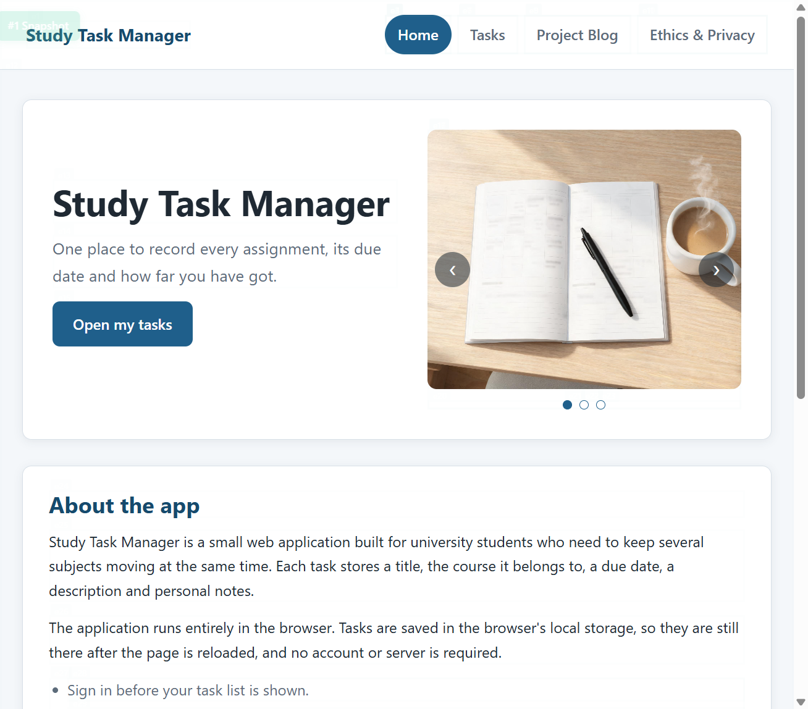
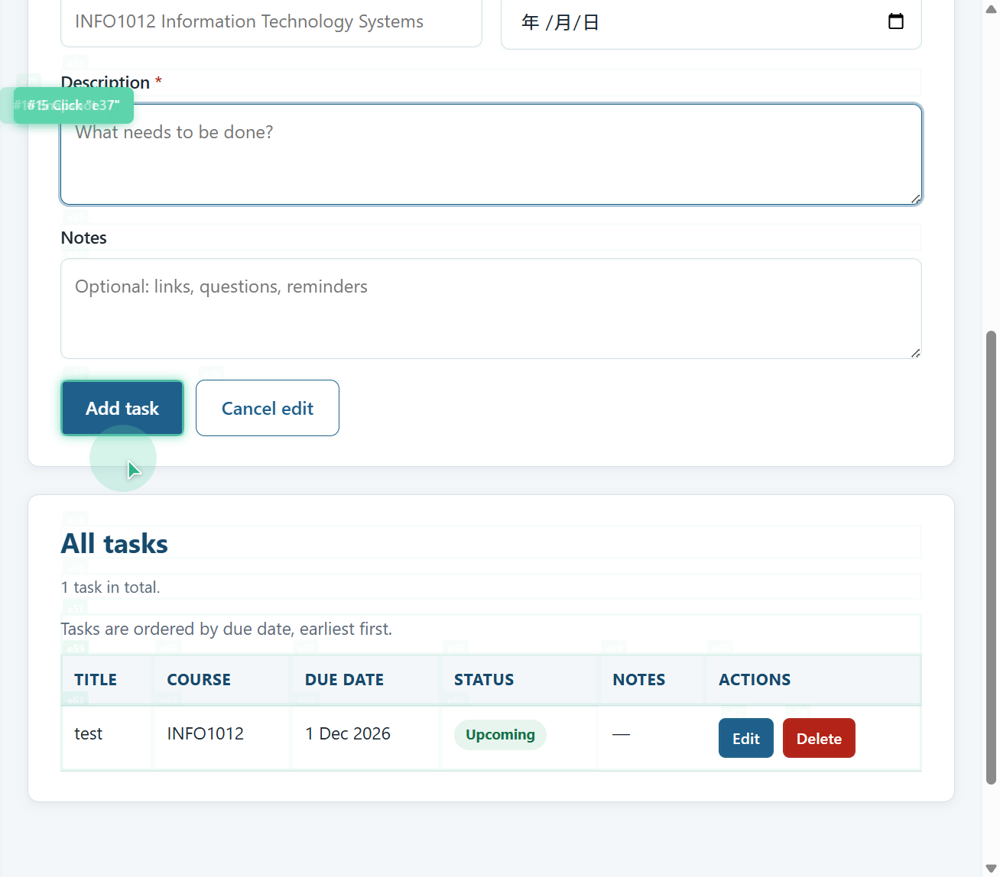
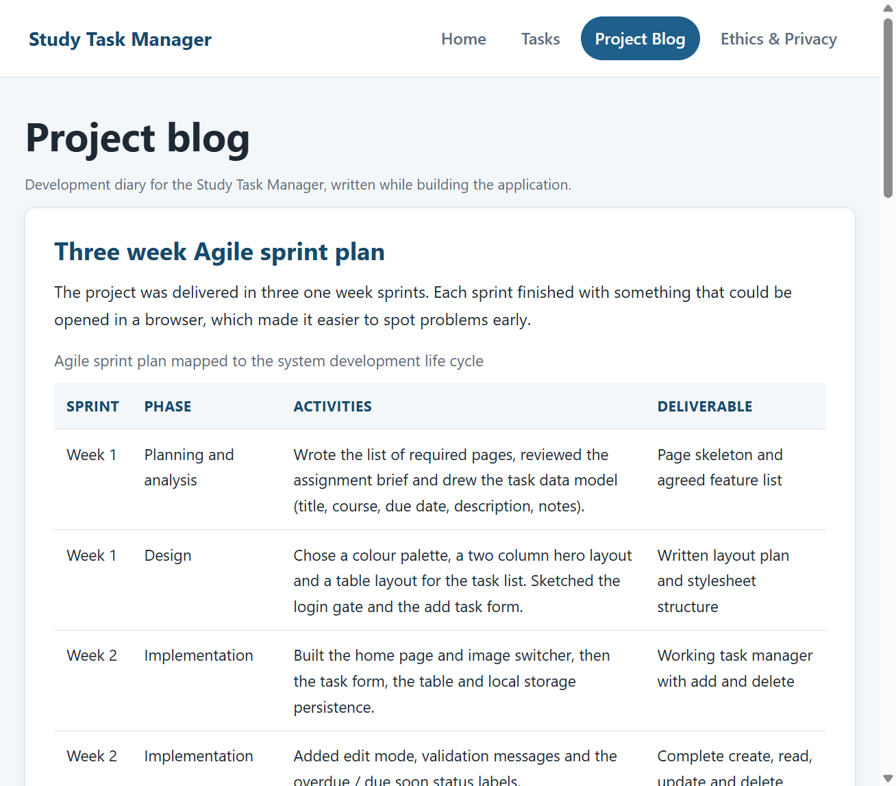
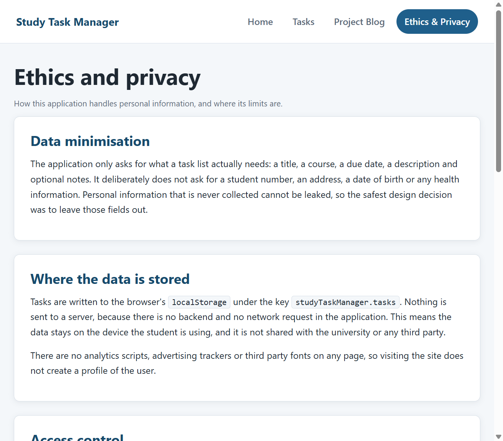

# Study Task Manager

Repository: https://github.com/Ziyue-student/ITS_3.1_StudyTask

A small web application for university students who need to track assignments across several
subjects. Each task stores a title, the course it belongs to, a due date, a description and
optional notes. Tasks are saved in the browser's local storage, so they survive a page reload.

Built for the **Information Technology Systems (INFO1012)** web page development assignment using
HTML, CSS, JavaScript and Markdown.

---

## Features

| Feature | Where |
|---|---|
| Image carousel with three images | Home page |
| About the app / About me sections | Home page |
| Login gate (task list hidden until signed in) | Tasks page |
| Create, edit and delete tasks | Tasks page |
| Confirmation dialog before deleting | Tasks page |
| Validation of required fields and due dates | Tasks page |
| Overdue / due soon / upcoming status labels | Tasks page |
| Tasks sorted by due date | Tasks page |
| Live date and time in the footer | Every page |
| Agile sprint plan and development error log | Project blog |
| Ethics and privacy reflection | Ethics page |

## Demo account

```
Username: student
Password: Study2026
```

The account is hard coded in `js/tasks.js` for demonstration only. It is not real security.

---

## Installation and running

No build step and no dependencies are required.

### Option 1 - open the file directly

1. Clone the repository:

   ```
   git clone https://github.com/Ziyue-student/ITS_3.1_StudyTask.git
   ```

2. Open `index.html` in a modern browser (Chrome, Edge or Firefox).

### Option 2 - run a local server (recommended)

From the project folder:

```
python -m http.server 8000
```

Then open `http://localhost:8000` in your browser.

---

## Usage guide

1. Open the home page. Use the left and right arrows, the dots below the image, or the keyboard
   arrow keys to switch between the three images.
2. Select **Tasks** in the navigation bar.
3. Sign in with the demo account shown above.
4. Fill in the task form:
   - **Task title** (required)
   - **Course code / name** (required)
   - **Due date** (required, must be a real date and cannot be in the past)
   - **Description** (required)
   - **Notes** (optional)
5. Select **Add task**. The task appears in the table, sorted by due date.
6. Select **Edit** on a row to load that task back into the form. Change the values and select
   **Save changes**, or select **Cancel edit** to discard the change.
7. Select **Delete** to remove a task. A confirmation dialog appears first.
8. Reload the page: your tasks are still there because they are stored in local storage.
9. Select **Sign out** to return to the login screen.

Validation messages appear above the form and the invalid field is marked with a red border.

---

## Project structure

```
ITS_3.1_StudyTask/
├── index.html              Home page
├── pages/
│   ├── tasks.html          Task management page
│   ├── blog.html           Agile plan and development error log
│   └── ethics.html         Ethics and privacy reflection
├── css/
│   └── style.css           All styling, layout and responsive rules
├── js/
│   ├── app.js              Image carousel and footer clock
│   └── tasks.js            Login, task CRUD, validation and storage
├── images/                 Images used on the home page
├── docs/                   Screenshots used in the README
└── README.md
```

---

## Screenshots

### Home page



### Task management page



### Project blog



### Ethics and privacy page



---

## Acknowledgements

- Assignment brief and marking rubric: Information Technology Systems (INFO1012), Adelaide
  University.
- Colour palette and layout inspired by the course practical examples.
- Photographs on the home page were generated for this project.

## Licence

This project is submitted as coursework. The code may be read and referenced for learning
purposes, but please do not submit it as your own assessment.

## Repository

- GitHub repository: https://github.com/Ziyue-student/ITS_3.1_StudyTask
